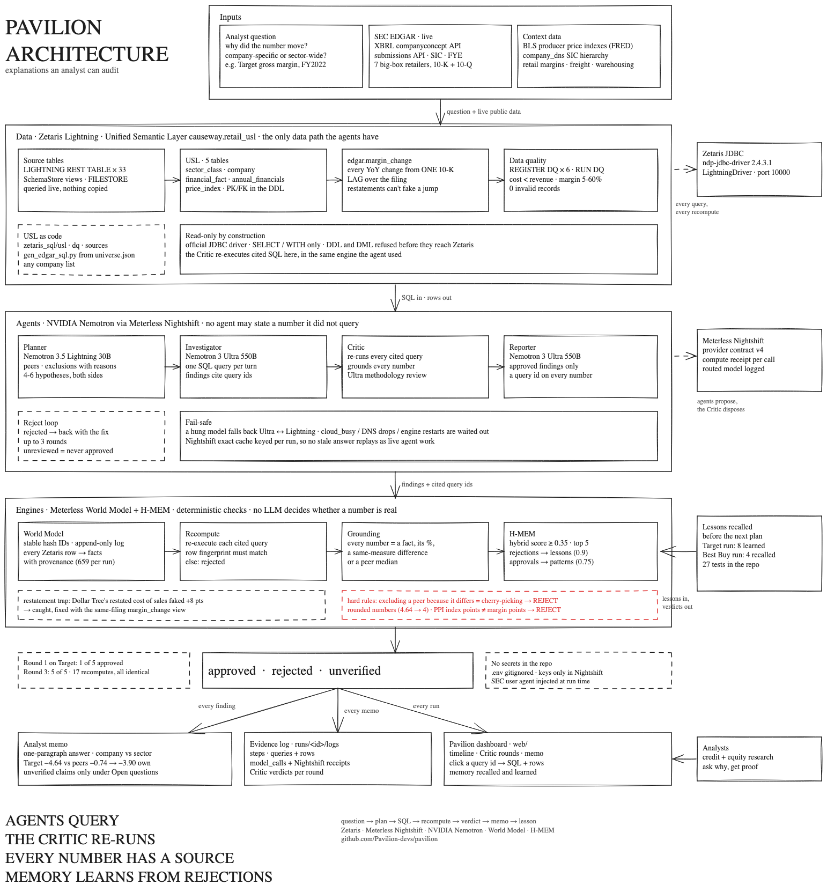

# Pavilion

**An agent that explains why a public company's numbers moved, and whether it was the company or the whole sector, where every number is checked against the data before an analyst sees it.**

Open Agent Hackathon 2026, Track 2: *The Agent That Can Explain Why*.

Ask: *"Why did Target's gross margin fall in fiscal 2022? Was it Target or the whole sector?"*

Pavilion answers with a memo: Target's gross margin fell **4.64 points** while the median of five big-box peers fell **0.74**, so **3.90 points were specific to Target**. Every number carries the id of the Zetaris query that produced it, and that query was re-run and matched before the number was allowed into the memo.

## Why this matters

Analysts asking *why* a margin moved spend hours pulling filings, lining up fiscal years, choosing peers and checking whether a change is real or a restatement. LLMs can draft that story in seconds, but they also invent numbers, cherry-pick peers and confuse units. Pavilion makes the explanation **auditable**: an agent can only state what a query returned, and a separate Critic tries to break each claim before it ships.

## How it works



The editable diagram is `docs/architecture/pavilion.excalidraw` (open it at excalidraw.com).

```
Analyst question
   │
   ▼
H-MEM recall ── lessons from earlier investigations (e.g. "don't read retail-margin PPIs as margin points")
   │
Planner (Nemotron Lightning) ── company, period, peer set, exclusions with reasons, 4-6 hypotheses
   │
Investigator (Nemotron Ultra) ── writes read-only SQL against the Zetaris semantic layer, one query per turn
   │
Critic ─┬─ 1. re-executes every cited query in Zetaris; rows must match exactly
        ├─ 2. every quoted number must be a fact from those rows (World Model), or a %/difference/median of them
        └─ 3. Nemotron Ultra methodology review (peer cherry-picking, restatements, units, causal wording)
   │       rejected findings go back to the Investigator with the specific fix, up to 3 rounds
   ▼
Reporter (Nemotron Ultra) ── memo from approved findings only, a query id on every number
   │
H-MEM learn ── Critic rejections become lessons; approved findings become patterns
```

**Data (Zetaris).** A Unified Semantic Layer (`causeway.retail_usl`) over three live sources:

| Source | What | How it gets into Zetaris |
|---|---|---|
| SEC EDGAR XBRL API | Revenue, cost of sales, operating income, inventory for 7 US retailers (TGT, WMT, COST, KR, DG, DLTR, BBY), every 10-K and 10-Q | `CREATE LIGHTNING REST TABLE`, queried live |
| SEC EDGAR submissions API | Company names, SIC codes, fiscal year ends | REST tables |
| company_dns SIC hierarchy + BLS producer price indexes (via FRED) | Sector classification; retail-margin, freight and warehousing PPIs | SchemaStore views and a FILESTORE table |

USL tables: `sector_class`, `company`, `financial_fact`, `annual_financials`, `price_index`, plus the `edgar.margin_change` view that computes every year-over-year change **within one 10-K**, so restatements can't fake a jump (Dollar Tree's restated cost of sales did exactly that). Six data-quality rules are registered with `REGISTER DQ` and run with `RUN DQ` (0 invalid records).

## Results from real runs

Both runs are in the replay page (`web/`), built from the runs' own logs. The full logs are in `runs/example/`: every step, every Zetaris query with its rows, every Critic verdict, and every Nightshift model call with its receipt (`logs/model_calls.jsonl`).

**Target, first run, empty memory.** The Critic rejected 4 of 5 findings in round 1:

- excluding Dollar Tree from the peer median because its margin rose ("cherry-picking"),
- quoting dollar figures that no cited query returned,
- reading retail-margin price indexes as gross-margin points,
- using year-end inventory to rule out problems during the year.

The Investigator fixed three in round 2 and the last in round 3, and all 5 findings were approved. The Critic re-ran the cited queries 17 times, and H-MEM learned 8 lessons.

**Best Buy, second run.** H-MEM recalled 4 of those lessons before planning, and no Best Buy finding repeated the price-index mistake. Result: −1.08 points vs a peer median of −0.74, so −0.34 points company-specific. Two findings stayed unapproved after 3 rounds because the Investigator rounded −10.55% to −11%; the memo lists them as unverified, not as conclusions.

Every model call carries a Nightshift compute receipt naming the model that served it. Target: 37 receipts, 32 on Nemotron Ultra and 5 on Nemotron Lightning.

## Sponsor technology

**Zetaris** is the only data path. The agent never sees raw files: it writes SQL against the USL over the official JDBC driver (`causeway/zetaris_client.py`). The Critic's recompute pass re-executes those queries in Zetaris. The DDL, DQ rules, cross-row checks and exploratory queries are in `zetaris_sql/`, and what we learned about the platform (11 findings, including the restatement trap, an int/bigint activation gap and DQ rules that can't use window functions) is in `docs/zetaris-findings.md`.

**Meterless Nightshift** is the only AI provider (`causeway/generator.py`). It implements Runtime provider contract v4: bearer auth, `meterless-app` / `meterless-scope` headers, `/v1/models` as the online check, and auto-detect. Every call is logged with its compute receipt, routed model, latency, tokens and cache status (`runs/<id>/logs/model_calls.jsonl`). Hardening found in real runs:

- Nightshift's exact-match cache ignores the system prompt, so each request carries a run and context tag.
- A model that hangs falls back to the other Nemotron model.
- `cloud_busy`, `cloud_unreachable` and `engine_not_running` are waited out instead of failing the run.

**NVIDIA Nemotron**, both models through Nightshift:

- `nemotron-3.5-lightning-30b-a3b` runs the Planner, with thinking off for speed.
- `nemotron-3-ultra-550b-a55b` runs the Investigator, Critic, Reporter and memory miner.

**Meterless engines**, implemented from the published specs, with tests:

- **World Model** (`causeway/engines/world_model.py`): stable hash IDs, an append-only event log with exactly-once appends, an ingest pipeline that turns every Zetaris result into facts with provenance, and a read surface with conflict detection. The Critic grounds every number in these facts.
- **H-MEM** (`causeway/engines/hmem.py`): working and long-term tiers, the hybrid retrieval score (semantic, keyword, tag, domain, entity, layer, recency, superseded penalty, times confidence, threshold 0.35), a trust ledger, feedback deltas, and mining with a direct-capture fallback.

**Coding agent.** Pavilion was built with Claude Code as the AI coding agent.

## Run it

Requirements: Python 3.11+, Java 17, Docker, the Zetaris Lightning bundle running locally, and Meterless Nightshift with an NVIDIA key in its Providers.

```bash
python3 -m venv .venv && .venv/bin/pip install -r requirements.txt
cp .env.example .env     # fill in Nightshift token, Zetaris login, JDBC jar path, SEC user agent
.venv/bin/python scripts/gen_edgar_sql.py && .venv/bin/python scripts/fetch_ppi.py
for f in zetaris_sql/sources/*.sql zetaris_sql/usl/*.sql zetaris_sql/dq/01_dq_rules.sql; do .venv/bin/python scripts/run_sql.py "$f" --skip-exists; done
.venv/bin/python -m pytest -q                       # 27 tests, no services needed
.venv/bin/python -m causeway status
.venv/bin/python -m causeway ask "Why did Target's gross margin fall in fiscal 2022? Was it Target or the whole sector?"
```

**The Pavilion dashboard (replays recorded runs, no services needed):**

```bash
.venv/bin/python scripts/build_replay.py runs/<run_id> [runs/<run_id> ...]   # optional: rebuild from your own runs
python3 -m http.server 8765 --directory web                                  # then open http://localhost:8765
```

`docs/demo-script.md` is the demo walkthrough. `SETUP.md` walks through the Zetaris, Nightshift and NVIDIA setup step by step.

## Repository

```
causeway/            agents, Critic, orchestrator, Nightshift generator, Zetaris client, evidence logs
causeway/engines/    World Model and H-MEM
zetaris_sql/         source tables, USL DDL, DQ rules, cross-row checks, exploratory queries
scripts/             SQL runner, EDGAR SQL generator, PPI fetch, Critic replay, replay bundler
tests/               27 tests: engines, Critic grounding, generator resilience
web/                 replay page and the recorded runs it plays
docs/                Zetaris findings and query evidence
```

## Limits and next steps

- A full run takes 50-60 minutes, and most of that is Nemotron Ultra calls that hang until the 180 s timeout. Model working time is about 15 minutes. Streaming responses would cut the hangs.
- The Investigator sometimes rounds numbers, which the Critic correctly rejects. The "cite numbers exactly" lesson exists in memory, but it ranked below the recall threshold for Best Buy.
- Seven retailers in one sector; the USL generator takes any company list from `zetaris_sql/universe.json`.
- Historical analysis of public filings. Not investment advice.
